  

  
  
  
  

### Research

I work on LLM tutors that teach rather than just answer: pedagogical alignment, math mistake remediation, personalized learning, and adaptive educational systems. I also build production AI systems, from voice agents to computer vision pipelines.

| Venue | Paper |
|:---|:---|
| **BEA 2026** | [Towards Pedagogically Aligned LLM Tutors for Math Mistake Remediation](https://aclanthology.org/2026.bea-1.10/) |
| **Molecular Physics 2026** | [Crystallography as language: Transforming structural data into textual description for LLM-aided materials discovery](https://doi.org/10.1080/00268976.2025.2610374) |
| **ICLR 2025 Workshop** | [A pilot study on the impact of LLMs on virtual tutoring for low- to middle-income countries](https://openreview.net/forum?id=EN8dGvVtIp) |
| **SOICT 2024** | [Enhancing Retrieval Augmented Generation with Hierarchical Text Segmentation Chunking](https://doi.org/10.1007/978-981-96-4288-5_17) |

### Open repositories

| Repository | What it is |
|:---|:---|
| [RMBoost-Edu](https://github.com/tiendat-aops/RMBoost-Edu) | Notebook-first reimplementation of RMBoost, reward model training with synthetic preference data |
| [Combining-LLM-with-KG-supports-disease-diagnosis](https://github.com/tiendat-aops/Combining-LLM-with-KG-supports-disease-diagnosis) | Large language models and knowledge graphs for disease diagnosis support |
| [Enhance_Machine_Translation_With_Self_Improve_Strategy](https://github.com/tiendat-aops/Enhance_Machine_Translation_With_Self_Improve_Strategy) | Machine translation with a self-improvement strategy |
| [Training-Word2Vec-From-Scratch-For-Vietnamese](https://github.com/tiendat-aops/Training-Word2Vec-From-Scratch-For-Vietnamese) | Word2Vec implemented from scratch for Vietnamese |

### Tools I build with

  
  
  
  
  
  
  
  

<picture>
  <source media="(prefers-color-scheme: dark)" srcset="https://raw.githubusercontent.com/tiendat-aops/tiendat-aops/output/snake-dark.svg">
  
</picture>
